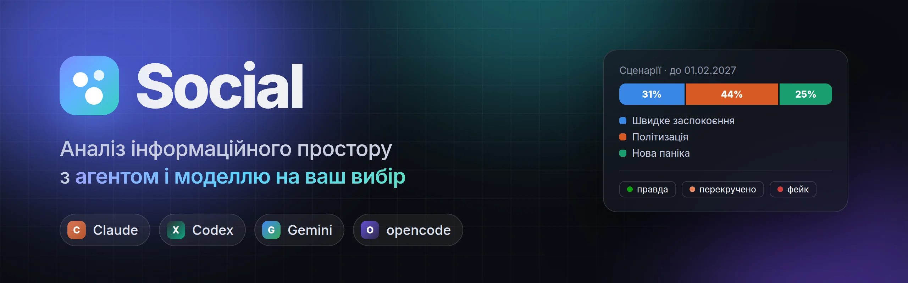
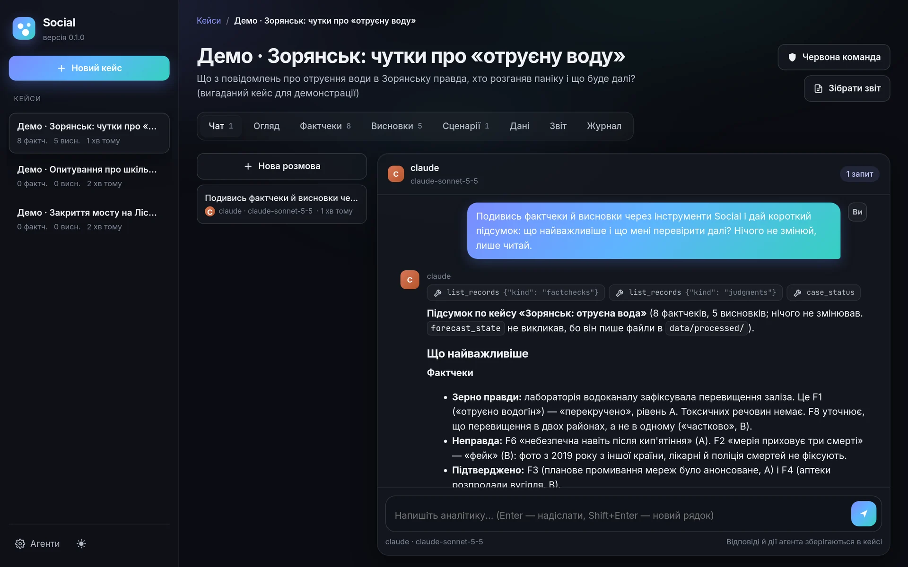
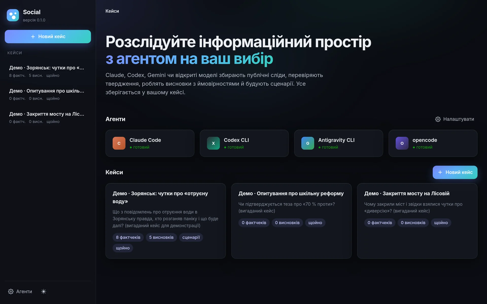
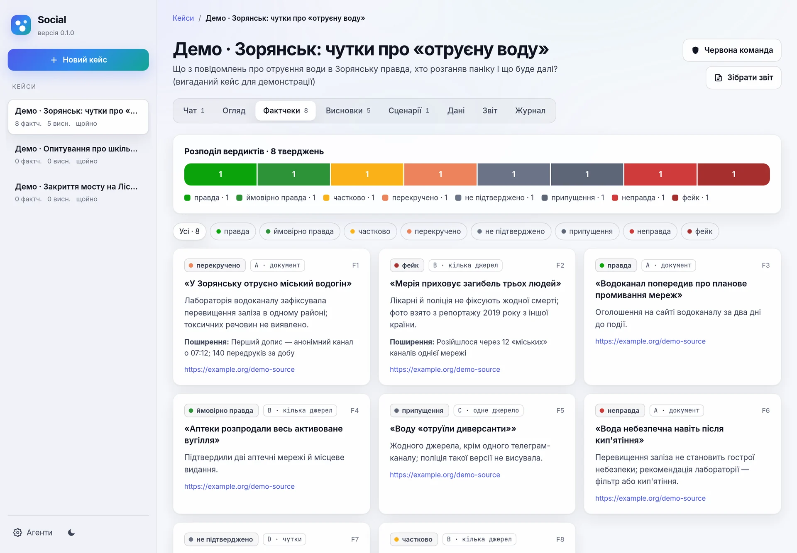
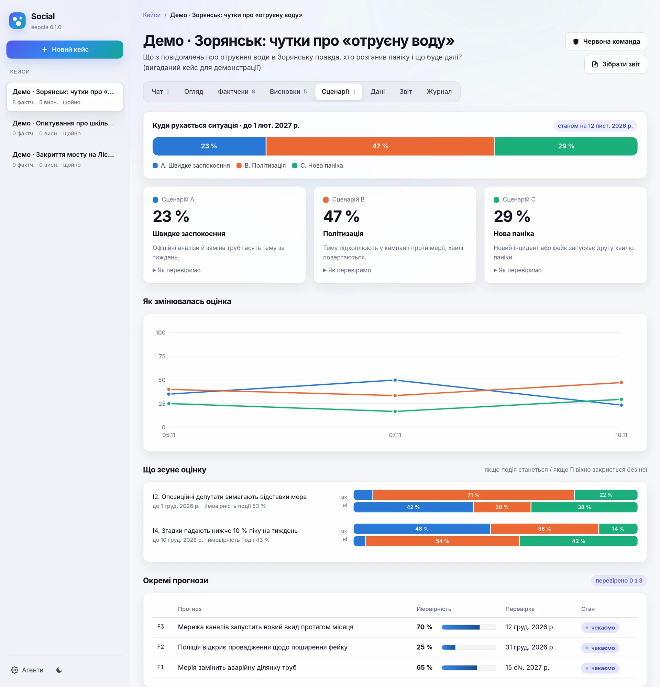
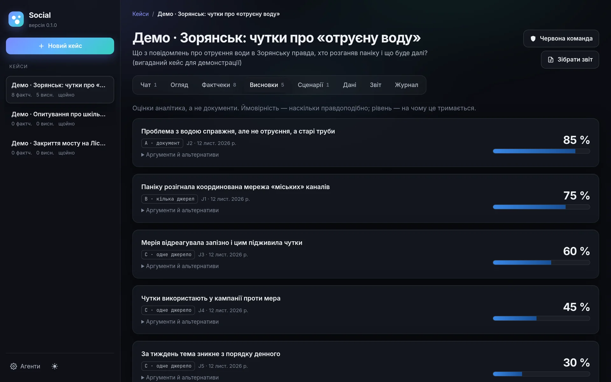
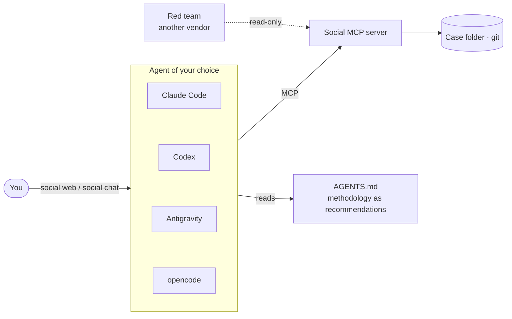

<p align="center">
  
</p>

<p align="center">
  <a href="https://github.com/cyberdid/social-framework/actions/workflows/tests.yml"></a>
  
  <a href="LICENSE"></a>
  
  <a href="https://doi.org/10.5281/zenodo.24101594"></a>
</p>

<p align="center">
  <a href="README.md">Українською</a> · <b>English</b>
</p>

---

**Social** is a workbench for investigating information incidents and conflicts. You talk to an analyst agent the same way you would in a chat. The agent:
- collects public traces from Telegram, YouTube and online media;
- checks claims;
- states **its own conclusions with probabilities**;
- builds scenarios that update as events happen;
- writes a plain-language report.

You choose the agent: **Claude Code, Codex, Antigravity (Gemini) or opencode**, each with any of its models. It runs on your existing subscription or on free models, so no API keys are needed.

<p align="center">
  
</p>

## Why Social

| | |
|---|---|
| 🧠 **The agent thinks, Social gives it footing** | The methodology is a set of recommendations, not rails: the agent decides how much to collect and what to write. A few limits are hard: public data, privacy, and raw data that never changes. |
| 🔁 **Any agent, any model** | Switch from Claude to Gemini mid-case: all state lives in files, so the next agent picks up exactly where the last one stopped. |
| 🛡️ **Red team** | One click and an agent from *another vendor* challenges the conclusions, fact-checks and scenarios. It cannot change the case. |
| 🎯 **Positions, not "insufficient evidence"** | Every conclusion carries a probability and an evidence level A–D. Scenarios are precommitted before analysis, probabilities update by Bayes' rule, and forecasts get Brier scores. |
| 💾 **Nothing gets lost** | Collectors run in the background and write each record to disk at once. After a power cut they resume where they stopped. |
| 🔒 **Local and private** | A case is a folder with git history on your machine. The web UI listens only on `127.0.0.1` behind a one-time key. |

## Quick start

**1. Install at least one agent and sign in:** [Claude Code](https://docs.claude.com/en/docs/claude-code), [Codex CLI](https://github.com/openai/codex), Antigravity CLI (`agy`) or [opencode](https://opencode.ai), which has free and local models.

**2. Install Social.** You need [uv](https://docs.astral.sh/uv/):

```sh
uv tool install "social-framework[youtube] @ git+https://github.com/cyberdid/social-framework"
social doctor
```

**3. Work.**

```sh
social web                                   # browser UI: cases, chat, fact-checks, scenarios, report
social new "Case title" --question "What do we want to find out?"
cd ~/SocialCases/case-title
social chat --agent claude --model claude-opus-5-5
social chat --agent agy --model gemini-4-argon-high
social review                                # red team by another vendor's agent
```

> For Antigravity, run `social setup agy` once. Other agents get the Social tools automatically.

## Web interface

<table>
  <tr>
    <td width="50%"></td>
    <td width="50%"></td>
  </tr>
  <tr>
    <td></td>
    <td></td>
  </tr>
</table>

What the web interface has:
- **Chat.** Answers stream in as they are written, with the agent's tool calls shown above them. You pick the agent and model for each conversation.
- **Red team.** A one-click review by another vendor's agent.
- **Case views:**
  - fact-checks with a verdict distribution;
  - judgment probabilities;
  - scenarios with history and a what-if view;
  - a forecast calendar;
  - background jobs, data, the report (HTML/PDF) and the log.

Dark and light themes are included, and the layout works on phones.

> The screenshots show a fictional demo case. The chat answer is real: Claude Sonnet 5.5 produced it through the Social tools.

## How it works



**MCP tools:**

| Area | Tools |
|---|---|
| State and log | `case_status`, `log_entry`, `precommit` |
| Collection (background, resumable) | `collect_telegram`, `collect_youtube`, `collect_news`, `archive_url`, `job_status` |
| Checks and judgments | `fact_check`, `judgment`, `list_records` |
| Scenarios | `forecast_define`, `forecast_observe`, `forecast_revise`, `forecast_resolve`, `forecast_state` |
| Report | `report_build` |

## Hard limits

- Public data only: no bypassing logins, CAPTCHAs or blocks.
- No profiling of private persons and no de-anonymising channel owners.
- Guilt is for courts to decide.
- Raw data is append-only.
- Keys and sessions stay in `~/.config/social/`.
- No payments without explicit consent.

## Research code

The repository also holds the research code accompanying the preprint *Social: An Evidence-Grounded Framework for Automated Social Conflict and Information Incident Analysis* ([DOI 10.5281/zenodo.24101594](https://doi.org/10.5281/zenodo.24101594)):
- `src/`: collectors and analysis;
- `schemas/`: JSON Schemas;
- `tests/`: tests.

Research corpora are not included because they contain personal data.

**Status.** This is research software, not a validated autonomous investigator. Passing tests show the software behaves as designed, not that its conclusions are true.

## Citation and license

Cite via [`CITATION.cff`](CITATION.cff). Licensed under [Apache 2.0](LICENSE).
