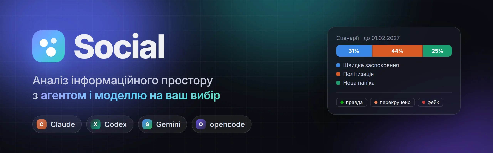
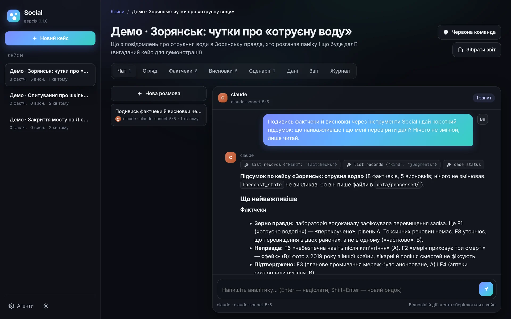
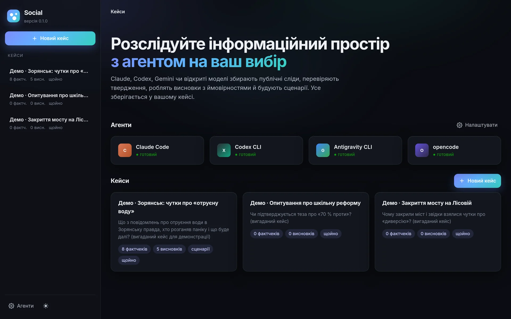
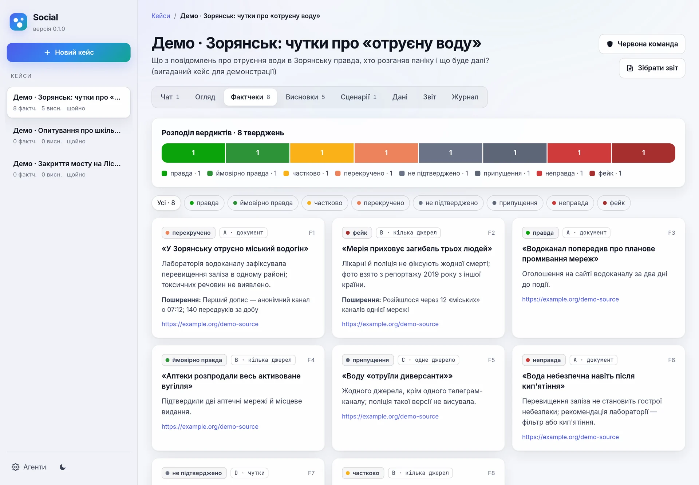
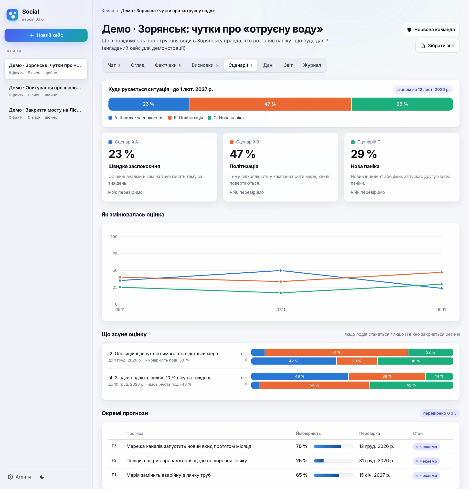
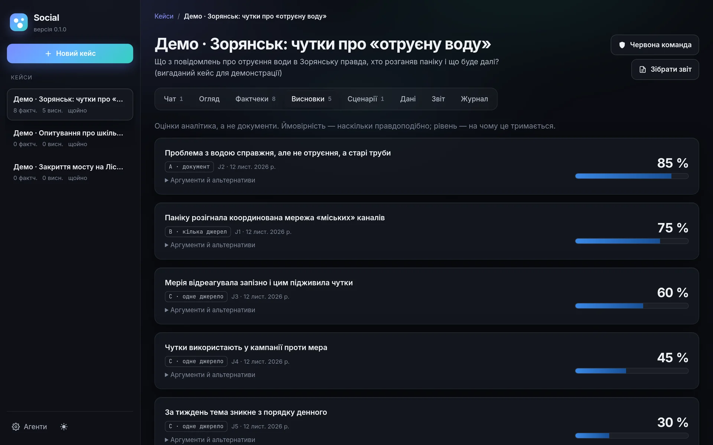
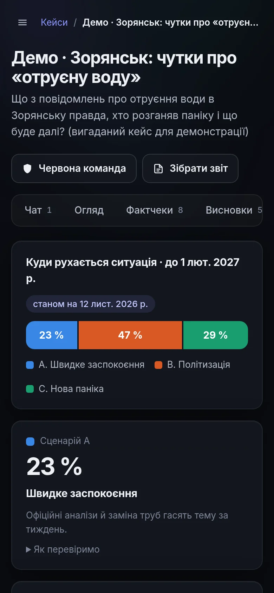
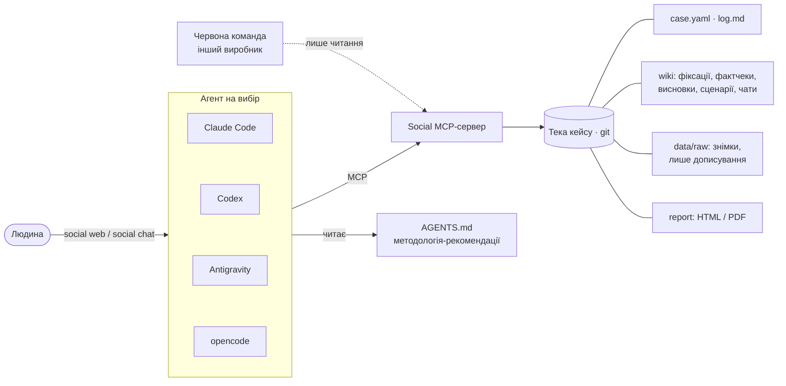

<p align="center">
  
</p>

<p align="center">
  
  <a href="LICENSE"></a>
  
  <a href="https://doi.org/10.5281/zenodo.24101594"></a>
</p>

<p align="center">
  <b>Українською</b> · <a href="README.en.md">English</a>
</p>

---

**Social** — це робоче місце аналітика інформаційного простору. Ви розмовляєте з агентом-аналітиком так само, як у чаті. Агент:
- збирає публічні сліди в Telegram, YouTube і онлайн-ЗМІ;
- перевіряє твердження;
- робить **власні висновки з ймовірностями**;
- будує сценарії, які оновлюються з новими подіями;
- пише зрозумілу довідку.

Агента обираєте ви: **Claude Code, Codex, Antigravity (Gemini) чи opencode**, кожен з будь-якою своєю моделлю. Агент працює на вашій підписці або на безкоштовних моделях, тож API-ключі не потрібні.

<p align="center">
  
</p>

## Чому Social

| | |
|---|---|
| 🧠 **Агент думає, Social дає опору** | Методологія — рекомендації, а не рамки: агент сам вирішує, скільки збирати й що писати. Твердих меж кілька: публічні дані, приватність, незмінність сирих даних. |
| 🔁 **Будь-який агент, будь-яка модель** | Перейдіть з Claude на Gemini посеред кейсу: увесь стан лежить у файлах, і новий агент продовжить з того самого місця. |
| 🛡️ **Червона команда** | Один клік, і агент *іншого виробника* оскаржує висновки, фактчеки й сценарії. Змінювати кейс він не може. |
| 🎯 **Позиція, а не «доказів недостатньо»** | Кожен висновок має ймовірність і рівень доказовості A–D. Сценарії зафіксовано до аналізу, ймовірності оновлюються за правилом Баєса, а прогнози отримують оцінку Браєра. |
| 💾 **Нічого не губиться** | Збори йдуть у фоні й пишуть кожен запис на диск одразу. Після вимкнення світла вони продовжують з того місця, де зупинилися. |
| 🔒 **Локально і приватно** | Кейс — це тека з git-історією на вашому комп'ютері. Веб-інтерфейс доступний лише з `127.0.0.1` за посиланням з одноразовим ключем. |

## Швидкий старт

**1. Агент.** Встановіть хоча б одного і увійдіть у нього:

| Агент | Моделі | Встановлення |
|---|---|---|
| Claude Code | Opus, Sonnet, Haiku | [docs.claude.com](https://docs.claude.com/en/docs/claude-code) |
| Codex CLI | моделі OpenAI | [github.com/openai/codex](https://github.com/openai/codex) |
| Antigravity CLI | Gemini, а також Claude і GPT-OSS | `agy` |
| opencode | безкоштовні та локальні моделі | [opencode.ai](https://opencode.ai) |

**2. Social.** Потрібен [uv](https://docs.astral.sh/uv/):

```sh
uv tool install "social-framework[youtube] @ git+https://github.com/cyberdid/social-framework"
social doctor             # що встановлено
```

**3. Робота.**

```sh
social web                # браузерний інтерфейс: кейси, чат, фактчеки, сценарії, звіт
```

Або в терміналі:

```sh
social new "Назва кейсу" --question "Що саме хочемо з'ясувати?"
cd ~/SocialCases/назва-кейсу
social chat                                        # Claude Code + Opus 5.5 за замовчуванням
social chat --agent agy --model gemini-4-argon-high
social chat --agent opencode --model opencode/big-pickle
social review                                      # червона команда
```

> Для Antigravity один раз виконайте `social setup agy`. Інші агенти отримують інструменти Social автоматично.

## Веб-інтерфейс

<table>
  <tr>
    <td width="50%"></td>
    <td width="50%"></td>
  </tr>
  <tr>
    <td><b>Кейси й агенти.</b> Видно, хто готовий до роботи; новий кейс створюється в один клік.</td>
    <td><b>Фактчеки.</b> Вердикт, рівень доказовості, «зерно правди», як поширювалось.</td>
  </tr>
  <tr>
    <td></td>
    <td></td>
  </tr>
  <tr>
    <td><b>Сценарії.</b> Ймовірності зараз, історія оцінок, «що буде, якщо», календар прогнозів.</td>
    <td><b>Висновки.</b> Власна позиція аналітика з ймовірністю, аргументами й альтернативами.</td>
  </tr>
</table>

<p align="center"></p>

Також у кейсі є вкладки «Огляд» (що робити далі), «Дані» (фонові збори й файли), «Звіт» (HTML і PDF) і «Журнал». Підтримуються темна й світла теми, інтерфейс працює й на телефоні.

> На знімках — вигаданий демо-кейс «Зорянськ». Відповідь у чаті справжня: її дав Claude Sonnet 5.5 через інструменти Social.

## Як це влаштовано



<details>
<summary><b>Інструменти Social для агента (MCP)</b></summary>

| Група | Інструменти |
|---|---|
| Стан і журнал | `case_status`, `log_entry`, `precommit` |
| Збір (у фоні, з відновленням) | `collect_telegram`, `collect_youtube`, `collect_news`, `archive_url`, `job_status` |
| Перевірка й висновки | `fact_check`, `judgment`, `list_records` |
| Сценарії й прогнози | `forecast_define`, `forecast_observe`, `forecast_revise`, `forecast_resolve`, `forecast_state` |
| Звіт | `report_build` |

Власні інструменти агента (shell, Python, вебпошук) теж доступні: свої колектори й аналіз агент пише в `analysis/`.
</details>

<details>
<summary><b>Усі команди</b></summary>

| Команда | Що робить |
|---|---|
| `social web` | веб-інтерфейс у браузері |
| `social new "Назва"` | створити кейс (тека + git) |
| `social chat [--agent A] [--model M]` | розмова з аналітиком в інтерфейсі самого агента |
| `social ask "питання"` | один запит без інтерфейсу; відповідь — у `wiki/sessions/` |
| `social review` | червона команда; рецензія — у `wiki/reviews/` |
| `social backends --models` | встановлені агенти та їхні моделі |
| `social config --agent A --model M [--role reviewer]` | агенти й моделі за замовчуванням |
| `social status`, `social jobs` | стан кейсу і фонові збори |
| `social setup agy` | одноразова реєстрація інструментів в Antigravity |
| `social doctor` | перевірка середовища |
</details>

## Тверді межі

Social призначений для аналізу **публічного** інформаційного простору:
- тільки публічні дані, без обходу входу, CAPTCHA чи блокувань;
- не профілювати приватних осіб і не деанонімізувати власників каналів;
- вину встановлює суд: діє презумпція невинуватості;
- сирі дані не змінюються;
- ключі й сесії зберігаються поза кейсом, у `~/.config/social/`;
- жодних платежів без прямого дозволу людини.

Відповідність законам і правилам платформ — відповідальність користувача.

## Дослідницький код

У репозиторії також лежить дослідницький код, який супроводжує препринт *Social: An Evidence-Grounded Framework for Automated Social Conflict and Information Incident Analysis* ([DOI 10.5281/zenodo.24101594](https://doi.org/10.5281/zenodo.24101594)):
- `src/` — колектори, підготовка знімків, аналіз, реєстр доказів, медіаконвеєр;
- `schemas/` — JSON-схеми;
- `tests/` — регресійні та контрактні тести.

Корпуси, коментарі, медіа й звіти досліджень сюди не входять, бо містять персональні дані. Деякі модулі `src/` ще містять ключові слова й шляхи з початкового кейсу. Застосунок `social/` використовує їхні узагальнені копії.

<details>
<summary>Запуск тестів дослідницького коду</summary>

```sh
python -m venv .venv && . .venv/bin/activate
pip install -r requirements-contracts.txt pytest numpy pandas scipy matplotlib telethon requests beautifulsoup4 datasketch networkx rapidfuzz pymorphy3 pymorphy3-dicts-uk pymorphy3-dicts-ru reportlab qrcode curl_cffi yt-dlp pyyaml trafilatura instaloader pillow av==18.1.0
pytest -q
```

Тести застосунку: `pip install -e ".[dev]" && pytest tests/test_social_app.py tests/test_social_web.py`.
</details>

**Статус.** Це дослідницьке програмне забезпечення, а не перевірений автономний слідчий. Пройдені тести показують, що програма поводиться як задумано, а не що висновки правдиві. Ймовірності — судження аналітика, а не каліброваних моделей, поки облік влучань не покаже інше.

## Цитування й ліцензія

Якщо використовуєте Social у дослідженні, цитуйте за [`CITATION.cff`](CITATION.cff). Код розповсюджується за ліцензією [Apache 2.0](LICENSE).
